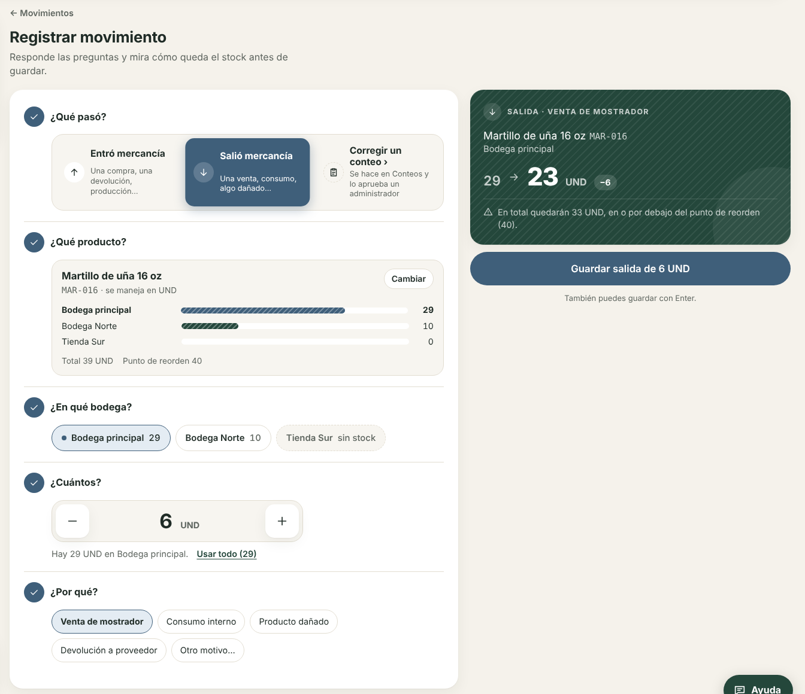
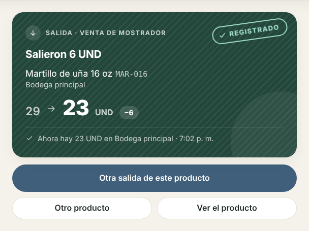
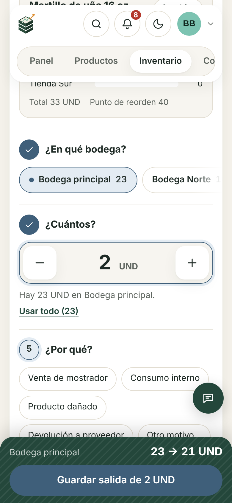

# Rediseño de formularios: registrar movimiento (fase 2)

El formulario de entradas y salidas ahora habla el mismo idioma visual que el panel y explica qué va a pasar antes de guardar. Es la fase 2 del plan de rediseño; las fases 3 (paneles laterales, transferencias, «Deshacer») y 4 (listas animadas, transiciones de página) quedan para después.

## Qué cambió

- **Preguntas en vez de campos:** ¿Qué pasó?, ¿Qué producto?, ¿En qué bodega?, ¿Cuántos?, ¿Por qué? Cada sección tiene su número; la que falta se resalta y las completas muestran una marca de verificación.
- **Comprobante en vivo:** tarjeta verde con el rayado de la tarjeta «Inventario» del panel. Muestra el saldo de la bodega antes y después («13 → 1 UND»), avisa si no alcanza y si el total queda en el punto de reorden o por debajo.
- **Color por tipo:** entrada en verde, salida en pizarra. El rojo quedó solo para errores (antes toda salida era roja).
- **Tarjeta del producto:** al elegirlo se ve el stock en cada bodega con barras rayadas, el total y el punto de reorden.
- **Bodegas como pastillas con su stock;** en una salida, las bodegas en cero aparecen deshabilitadas con «sin stock». Con más de 6 bodegas se usa una lista desplegable.
- **Cantidad con botones − y +** (mantener presionado repite; las flechas del teclado también funcionan) y el enlace «Usar todo» en salidas.
- **Motivo:** los frecuentes como chips y «Otro motivo…» despliega el campo de texto.
- **Productos usados hace poco** como atajos cuando el buscador está vacío.
- **Validación amable:** los errores aparecen al salir del campo o al guardar; al guardar con datos faltantes hay un resumen con enlaces y el foco va al primer campo. Que la salida supere el stock se avisa de inmediato.
- **Éxito con sello:** el comprobante recibe el sello «Registrado» y ofrece «Otra salida de este producto» (conserva producto, bodega y motivo; el foco queda en la cantidad), «Otro producto» y «Ver el producto».
- **Celular y tableta:** barra fija abajo con el saldo resultante y el botón de guardar; el botón de Ayuda sube y se reduce a ícono para no taparla.

## Decisiones

- **«Corregir un conteo» lleva a Conteos.** La API de movimientos solo acepta entradas y salidas, y los ajustes pasan por un conteo que aprueba un administrador (`counts:approve`). Agregar ajustes directos en este formulario se saltaría esa aprobación, así que la tercera opción explica dónde se hace.
- **Sin librería de animación.** Todo es CSS (tokens `--dur-*` y `--ease-*` en `forms.css`) y un hook de 30 líneas para las cifras (`useAnimatedNumber`). Motion se evaluará en la fase 4 para las listas.
- **Proteger lo escrito solo al cerrar o recargar la pestaña.** `useBlocker` de React Router necesita un router de datos y la app usa `BrowserRouter`; cambiarlo es otro trabajo.
- **El formulario se carga bajo demanda** (`lazy` en `App.tsx`): el paquete inicial queda en 489 kB, por debajo del aviso de 500 kB de Vite.
- **Movimiento reducido:** con esa opción del sistema no hay desplazamientos ni escalas; el sello y las tarjetas aparecen con un fundido de 120 ms y las cifras muestran el valor final sin contar.

## Archivos

| Archivo | Qué hace |
| --- | --- |
| `frontend/src/forms.css` | Tokens de color por movimiento y de animación, estilos del formulario, comprobante y barra |
| `frontend/src/components/form/FormSection.tsx` | Sección numerada con su pregunta |
| `frontend/src/components/form/PillGroup.tsx` | Radios nativos con aspecto de pastilla |
| `frontend/src/components/form/QuantityStepper.tsx` | Cantidad con − y + |
| `frontend/src/components/form/ReceiptCard.tsx` y `receipt.ts` | Comprobante en vivo, sello y cálculos |
| `frontend/src/lib/useAnimatedNumber.ts`, `lib/quantity.ts` | Cifras que corren y lectura de cantidades |
| `frontend/src/pages/inventory/MovementFormPage.tsx` | El formulario |

## Cómo se probó

- 10 pruebas nuevas en Vitest (`MovementFormPage.test.tsx`, `QuantityStepper.test.tsx`); el total del frontend queda en 26.
- En Chromium con Playwright: escritorio (1440 px) y celular (390 px), claro y oscuro, movimiento reducido, recorrido solo con teclado (Enter guarda desde cualquier campo) y sin desbordamiento horizontal.
- axe sin errores en el formulario ni en la pantalla de éxito (el único aviso es el contraste del logotipo en la barra superior, que ya existía).
