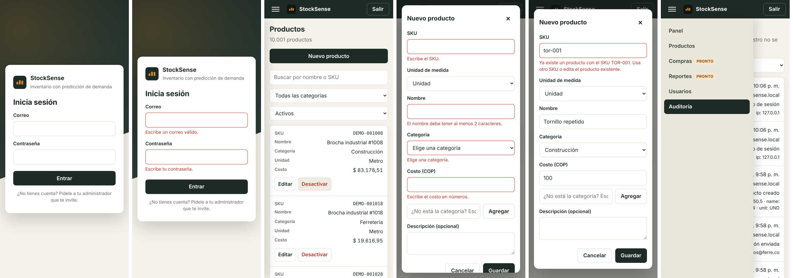
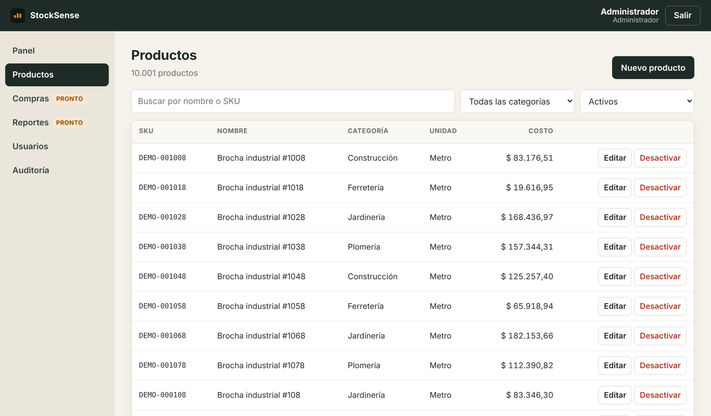

# Entrega del Sprint 1

**Objetivo:** base segura: acceso, entorno automatizado y catálogo.
**Fechas:** 28 de septiembre al 2 de octubre de 2026 (Sprint 1 del tablero GG).
**Resultado:** 3 de 4 historias terminadas (15 de 23 puntos). HU-03 queda en curso porque necesita el repositorio en GitHub y un servidor de staging.

| Historia | Jira | Puntos | Estado | Evidencia |
| --- | --- | --- | --- | --- |
| HU-01 Iniciar sesión de forma segura | GG-11 | 5 | Terminada | `backend/test/auth.e2e-spec.ts` (12 pruebas) |
| HU-02 Gestionar usuarios y roles | GG-12 | 5 | Terminada | `backend/test/users.e2e-spec.ts` (9 pruebas) |
| HU-03 Entorno base y despliegue continuo | GG-13 | 8 | En curso | Ver "Pendiente" |
| HU-04 Crear, editar y buscar productos | GG-14 | 5 | Terminada | `backend/test/products.e2e-spec.ts` (10 pruebas) |

## Criterios de aceptación verificados

Todas las pruebas corren contra PostgreSQL 16 real. Resultado: 46 pruebas de backend y 7 de frontend en verde, cobertura de 94% en sentencias del backend.

| Criterio | Cómo se comprobó | Resultado |
| --- | --- | --- |
| HU-01: entra al panel en menos de 2 s | Prueba automática + navegador real | 0,22 s del clic en "Entrar" al panel |
| HU-01: 5 contraseñas incorrectas bloquean 15 min con mensaje claro | Prueba automática | Avisa los intentos restantes; al quinto responde 423 con el mensaje de bloqueo |
| HU-01: 30 min de inactividad cierran la sesión | Prueba automática (sesión simulada a 31 min) | La API cierra la sesión; la web también cierra sola |
| HU-02: invitación por correo para definir contraseña | Prueba automática del flujo completo | El enlace vence en 72 h y sirve una vez |
| HU-02: Bodega recibe acceso denegado en Compras y Reportes | Prueba automática + pantalla "Acceso denegado" | 403 en la API; el menú no muestra esas secciones |
| HU-02: auditoría con fecha y autor | Prueba automática | Creación, cambio de rol (con valor anterior y nuevo) y desactivación |
| HU-04: crear con nombre, categoría, unidad y costo | Prueba automática | SKU se guarda en mayúsculas |
| HU-04: SKU repetido con error claro | Prueba automática + navegador | "Ya existe un producto con el SKU TOR-001…" |
| HU-04: búsqueda en menos de 1 s | 10.000 productos de prueba | 54 ms en el navegador, todas las consultas bajo 1 s en la prueba |
| T-01.3 y T-04.3: funcionan en celular | Capturas a 390 px de ancho | Ver imagen abajo |

## Pendiente de HU-03 (GG-13)

El código y la configuración están listos; faltan pasos que requieren cuentas externas:

1. **GG-48:** `docker compose up --build` no se pudo ejecutar en el ambiente donde se construyó (sin acceso a Docker Hub). Se validó la sintaxis del archivo y se comprobó el arranque sin Docker desde un clon limpio (20 s con dependencias en caché). Falta correrlo una vez en un equipo con Docker Desktop.
2. **GG-49:** el workflow de CI existe, pero hay que crear el repositorio en GitHub y activar la protección de ramas para que un pull request con CI fallido no se pueda fusionar.
3. **GG-50:** falta elegir el proveedor de staging, crear su base de datos y guardar el secreto `STAGING_DEPLOY_HOOK`. Los pasos están en [ambientes.md](ambientes.md).

## Decisiones tomadas

- **Sesiones en servidor además del JWT:** permite que "Salir" y la inactividad cierren la sesión de verdad, no solo en el navegador.
- **bcrypt (bcryptjs) en vez de argon2:** no necesita compilar código nativo, así funciona igual en Windows, Linux y Docker.
- **Los productos se desactivan, no se borran:** los movimientos de inventario del sprint 2 dependerán de ellos.
- **Bodega no ve costos:** se aplicó el permiso `products:cost:read`, coherente con la historia HU-25 del sprint 9.
- **Migraciones escritas a mano:** el esquema queda explícito y revisable en `backend/src/database/migrations`.
