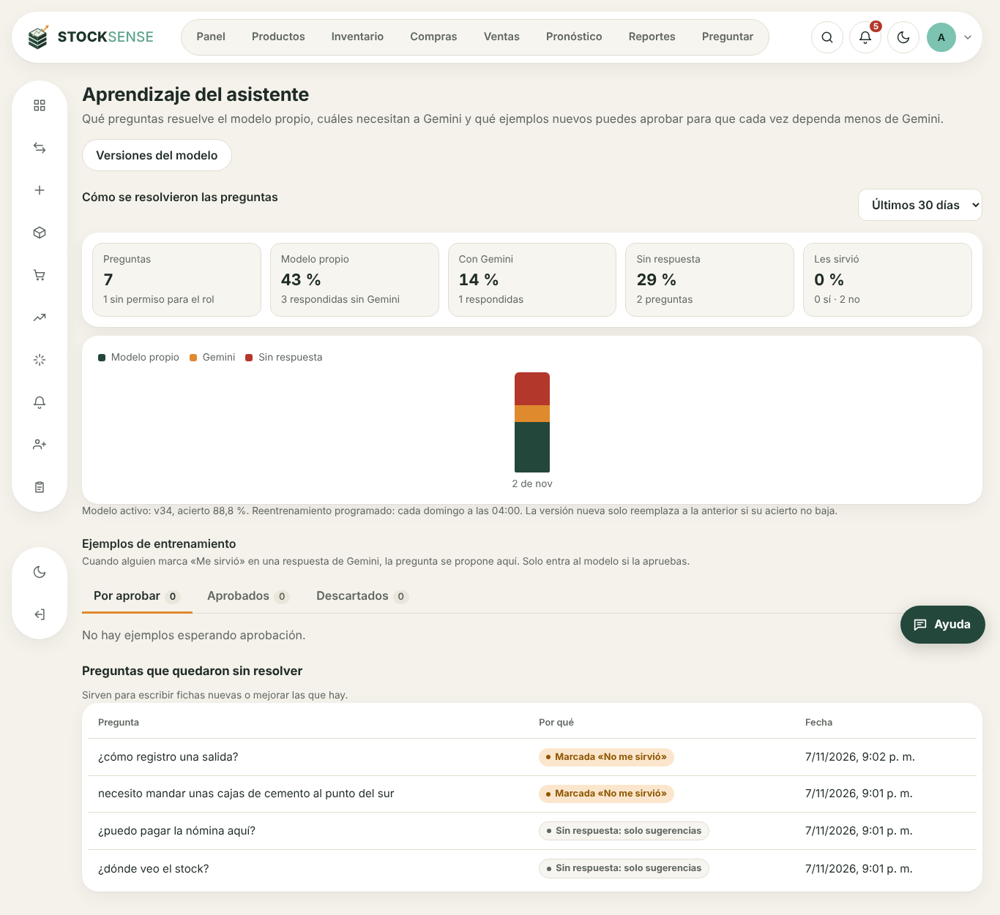
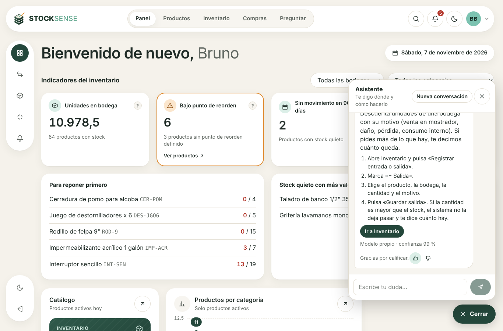
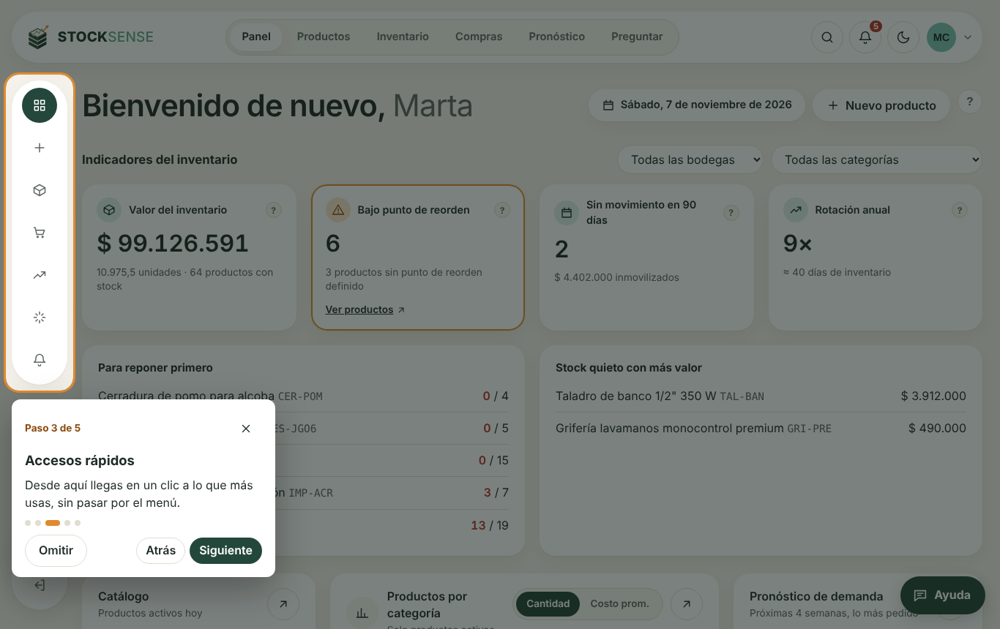
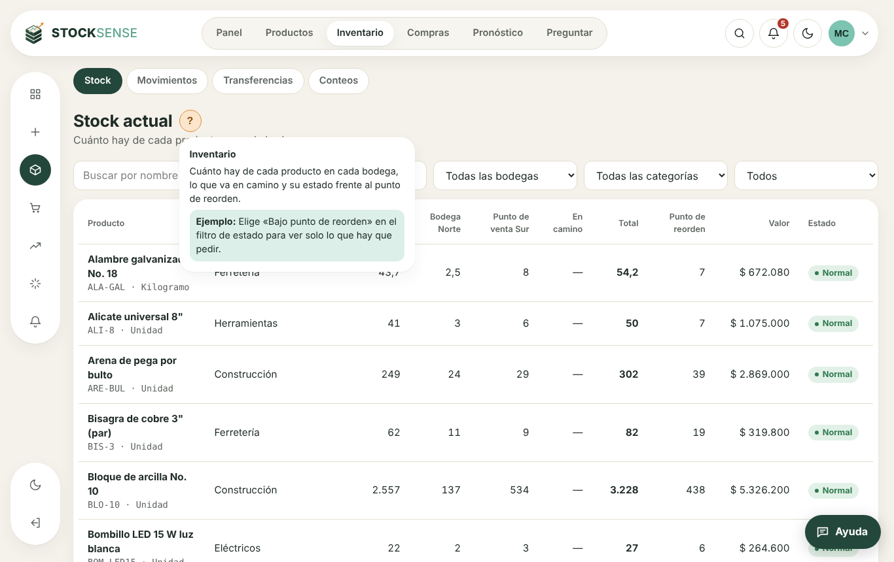

# Entrega del sprint 10: calidad, ayuda, aprendizaje del asistente y lanzamiento

**Resultado:** HU-29 (rendimiento y seguridad) y HU-36 (el asistente aprende con el uso) están completas. HU-30 (ayuda en la aplicación) tiene todo menos grabar el video y la revisión de los manuales por una persona de cada rol. De HU-31 (piloto y producción) está listo lo que no depende del negocio real: plan, guía de carga, encuesta, soporte y el retorno ensayado.

Pruebas en verde:
- **Backend:** 190 pruebas; las nuevas cubren el aprendizaje del asistente, las 122 rutas con los 4 roles y los datos de demostración.
- **Frontend:** 31 pruebas.
- **Servicio de Python:** 44 pruebas, más 1 que solo corre con la base de pruebas.

| Historia | Jira | Estado | Detalle |
| --- | --- | --- | --- |
| HU-29 Probar el rendimiento y la seguridad | GG-39 | Lista | [rendimiento-y-seguridad.md](rendimiento-y-seguridad.md) |
| HU-30 Tener ayuda dentro de la aplicación | GG-40 | Falta el video y la revisión de los manuales | [manuales/](manuales/), [guion-video.md](guion-video.md) |
| HU-31 Hacer un piloto y salir a producción | GG-41 | Preparada; falta hacer el piloto | [piloto-y-lanzamiento.md](piloto-y-lanzamiento.md) |
| HU-36 Mejorar el asistente con el uso | GG-140 | Lista | Abajo |

## Criterios de aceptación

| Criterio | Resultado |
| --- | --- |
| HU-29: con 50 usuarios, pantallas en menos de 2 s | p95 de 44 ms con k6 y 50 cuentas distintas, 0 % de errores. Se corrigió un cuello de botella: el límite de peticiones se contaba por IP y una oficina entera compartía 300 por minuto |
| HU-29: OWASP Top 10 sin críticas ni altas | 3 altas corregidas en dependencias, CSP y protección contra marcos en el frontend, documentación de la API apagada en producción y limpieza de SQL en Python. Una prueba revisa las 122 rutas con los 4 roles |
| HU-29: restauración de respaldo probada | Scripts `respaldo.sh` y `restaurar.sh` probados de punta a punta. La prueba encontró y corrigió un error: el respaldo de seguridad podía sobrescribir el archivo que se iba a restaurar |
| HU-30: recorrido de 5 pasos que se puede omitir | Aparece la primera vez en el panel; «Omitir» o Esc lo cierran; se repite desde el menú de la cuenta. Funciona en el celular |
| HU-30: botón de ayuda con texto breve y ejemplo en cada pantalla principal | Un «?» junto al título en 25 pantallas, con explicación y ejemplo; una prueba revisa que las pantallas principales lo tengan |
| HU-30: manual de una página por rol y video corto | 4 manuales escritos. Guion del video de 2:40 (entrada, alerta y pronóstico); **falta grabarlo** |
| HU-31: piloto de 5 a 10 personas durante 5 días | Plan día por día y guía para cargar 100 productos con 12 semanas de ventas. **Falta el negocio y el grupo** |
| HU-31: formulario de comentarios y críticos corregidos | 12 preguntas listas para Google Forms y reglas para priorizar problemas |
| HU-31: retorno probado y soporte definido | Se revirtió la migración, arrancó la versión del sprint 9 con todos los datos y se volvió a publicar el sprint 10. Canal de soporte definido |
| HU-36: «Me sirvió» y «No me sirvió» en cada respuesta | En el chat de ayuda; queda en `assistant_messages.rating` |
| HU-36: lo que Gemini respondió bien se propone y un administrador lo aprueba | La pregunta se propone sin datos personales; el administrador puede corregir la ficha y el texto. Queda en la auditoría |
| HU-36: reentrenamiento programado que solo reemplaza si no baja | Cada domingo a las 4:00 a. m. con los ejemplos aprobados; la versión nueva solo se activa si su acierto es igual o mayor. Los ejemplos que repiten preguntas del conjunto de prueba no entran al entrenamiento |
| HU-36: panel con modelo propio, Gemini y sin respuesta | Configuración de IA › «Aprendizaje y ejemplos»: porcentajes, satisfacción, tendencia de 8 semanas y preguntas sin resolver |









## Pendiente que necesita personas

1. **GG-131:** grabar el video con el guion de [guion-video.md](guion-video.md) (menos de 3 minutos).
2. **GG-130:** que una persona de cada rol lea su manual y diga si se entiende.
3. **GG-132 a GG-134:** conseguir el negocio piloto, cargar sus datos, hacer los 5 días con la encuesta y elegir el servidor de producción (y repetir allá el ensayo del retorno).

## Cómo probarlo

```bash
docker compose up --build -d
docker compose exec backend npm run seed:reset
```

1. Entra como `bruno@demo.co`: aparece el recorrido guiado. Ciérralo y repítelo desde tu avatar.
2. En cualquier pantalla, pulsa el «?» junto al título.
3. Abre «Ayuda», pregunta algo y pulsa el pulgar.
4. Entra como administrador: Configuración de IA › «Aprendizaje y ejemplos».
5. Prueba de carga: `docker compose exec backend npm run seed:load-users` y luego `k6 run -e BASE_URL=http://localhost:8080/api load/pantallas.js`.

## Decisiones tomadas

- **Límite de peticiones por persona.** Con sesión válida se cuenta por persona; sin sesión, por IP. El inicio de sesión sigue con su límite propio de 20 por minuto por IP.
- **La pregunta, no la respuesta, es el ejemplo.** El modelo aprende a reconocer la pregunta y la responde con la ficha, que es la fuente verificada. Lo que dijo Gemini se muestra solo para que el administrador decida.
- **El recorrido se guarda en la cuenta**, no en el navegador: no vuelve a salir en otro equipo.
- **Ayuda en un solo lugar** (`frontend/src/lib/pageHelp.ts`). Cada página la recibe sola según su ruta, sin tocar las páginas.
- **El script del modo oscuro salió del HTML**, para que la política de contenido no tenga que permitir scripts en línea.
- **Corrección de paso:** la rotación del panel salía distinta según la hora del día (por ejemplo, 4 o 4,01 con los mismos datos). Ahora los días se cuentan en la base, por fechas.
