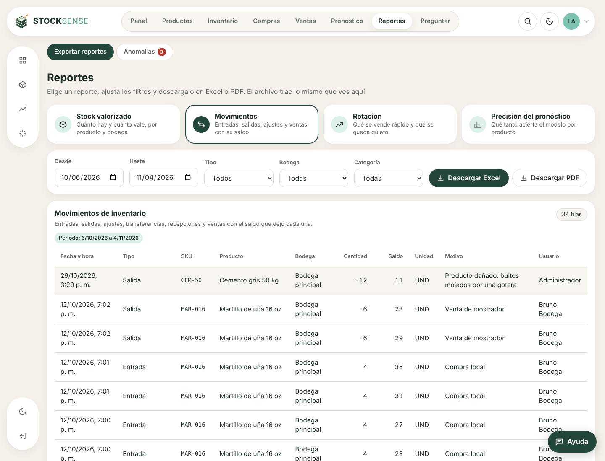
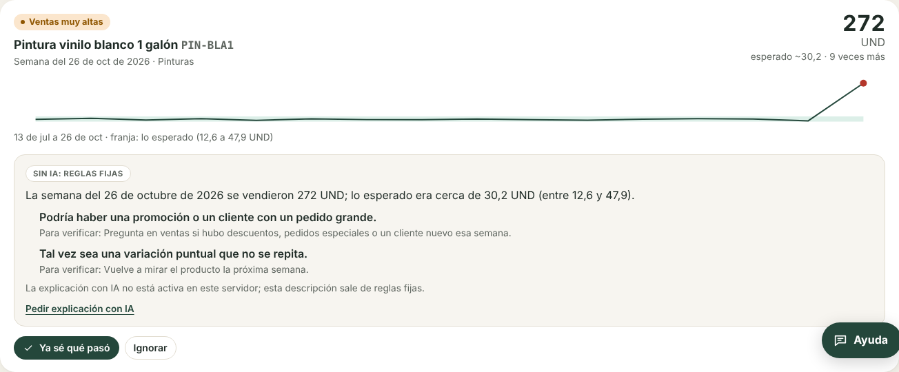
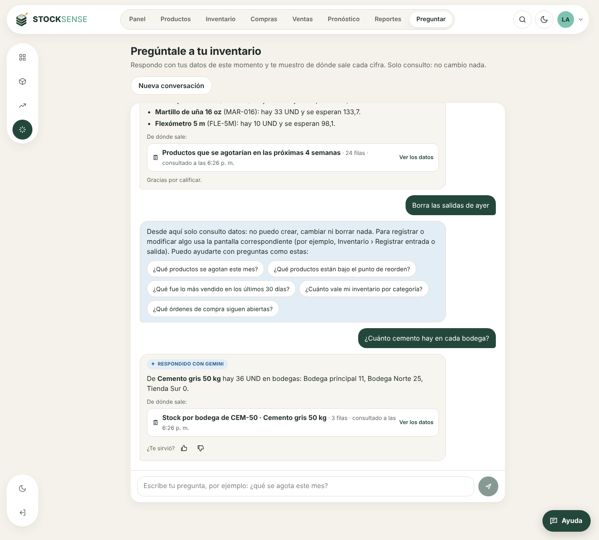
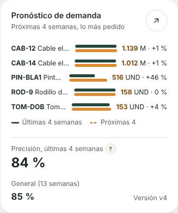

# Entrega del sprint 9: reportes, anomalías y preguntas al inventario

**Resultado:** las 3 historias tienen código, pruebas y pantallas. Quedan 3 cosas que necesitan personas: aprobar las plantillas de los reportes con la persona analista (T-28.1) y correr con la clave real de Gemini la evaluación de 20 preguntas (T-25.2) y la descripción de anomalías (T-26.2).

Pruebas en verde: **174 de backend** (18 nuevas), **26 de frontend** y **42 del servicio de Python** (10 nuevas, 1 contra PostgreSQL real que siembra los 5 casos de anomalía).

| Historia | Jira | Evidencia automática |
| --- | --- | --- |
| HU-25 Hacer preguntas al inventario en lenguaje natural | GG-35 | `backend/test/sprint9.e2e-spec.ts` (HU-25), `backend/src/data-chat/eval-data-chat.ts` |
| HU-26 Detectar y explicar anomalías | GG-36 | `forecast/tests/test_anomalies.py`, `backend/test/sprint9.e2e-spec.ts` (HU-26) |
| HU-28 Exportar reportes a PDF y Excel | GG-38 | `backend/test/sprint9.e2e-spec.ts` (HU-28 y T-28.3) |

## Criterios de aceptación verificados

| Criterio | Resultado |
| --- | --- |
| HU-25: responde con datos reales consultados en ese momento y muestra de dónde salieron | Cada respuesta trae sus fuentes: título, filas y hora de la consulta, con la tabla de datos al pulsar «Ver los datos» |
| HU-25: fuera de alcance, lo dice con amabilidad y sugiere preguntas válidas | Gemini llama a `fuera_de_alcance` y la API responde con un mensaje según el motivo y sugerencias del rol |
| HU-25: Bodega no ve costos ni márgenes | A Gemini solo se le ofrecen las herramientas del rol; si pide otra se rechaza. Prueba: Bodega pregunta el valor del inventario y ningún costo sale del servidor |
| HU-25: ninguna pregunta puede modificar datos | Las herramientas son SELECT dentro de `BEGIN TRANSACTION READ ONLY`; prueba: un INSERT ahí falla con «read-only transaction» |
| T-25.1: herramientas con pruebas y sin escritura | 10 herramientas: buscar productos, stock por bodega, bajo el punto de reorden, por agotarse, pronóstico, ventas, movimientos, valor del inventario, órdenes abiertas, anomalías |
| T-25.2: 20 preguntas de prueba bien y prohibidas rechazadas | Mecánica probada con Gemini simulado. La evaluación con Gemini real queda lista: `npm run eval:data-chat` (15 preguntas válidas en 4 roles y 5 prohibidas) |
| T-25.3: historial de la sesión, fuente y pulgar arriba o abajo | Historial en la pestaña (se borra al cerrarla); la calificación queda en `ai_feedback.rating` |
| HU-26: ventas fuera de 3 desviaciones estándar se marcan como anomalía | Ventas altas, ventas bajas y mermas; desviación con piso (raíz del promedio y 1 unidad) para no alarmar por una unidad |
| T-26.1: detecta los 5 casos sembrados | Promoción, error de digitación, caída, rebote tras quiebre y merma por vencimiento; también detecta el quiebre previo al rebote. Menos de 2 % de falsas alarmas en 300 series normales |
| HU-26: descripción de Gemini con hipótesis como posibilidades | Se rechaza si una hipótesis no está escrita como posibilidad, si afirma una causa («se debió a») o si trae cifras que no están en los datos; un reintento y, si no, descripción por reglas |
| HU-26: «explicada» o «ignorar» y no vuelve a aparecer | Una anomalía por producto, tipo y semana; volver a detectarla no cambia el estado que le dio la persona. Queda en la auditoría |
| HU-28: 4 reportes con los filtros aplicados | Stock valorizado, movimientos, rotación y precisión del pronóstico; vista previa y archivo salen de la misma consulta |
| HU-28: 10.000 filas en menos de 30 s | Prueba automática con 10.003 movimientos: PDF de unas 300 páginas y Excel en pocos segundos cada uno |
| HU-28: fecha de generación y quién lo generó | En el encabezado del Excel y en el encabezado y el pie de cada página del PDF; además queda en la auditoría |
| T-28.2: abre sin errores en Excel y en un visor de PDF | Cifras como números con formato, filtro automático y títulos fijos en Excel; PDF horizontal con «Página X de Y» |
| T-28.3: precisión de las últimas 4 semanas en el panel | Tarjeta de pronóstico: 84 % en la demo. Compara cada semana con el pronóstico que se tenía antes; mientras no haya versiones anteriores usa la prueba hacia atrás |







La captura del chat se tomó con un Gemini simulado que pide las herramientas (en este entorno no hay clave real). La consulta a la base, la validación de cifras, las fuentes y la calificación son las reales.



## Pendiente que necesita personas

1. **T-28.1 (GG-123):** revisar con la persona analista las columnas de los 4 reportes y aprobarlas (o pedir cambios).
2. **T-25.2 (GG-115):** con la clave real en el `.env`, correr `docker compose exec backend npm run eval:data-chat` y pegar la tabla que imprime en la subtarea. Gasta entre 20 y 60 llamadas a Gemini.
3. **T-26.2 (GG-118):** con la clave real, abrir Reportes › Anomalías, pulsar «Explicar posibles causas» en los 3 casos de la demo y revisar que el texto use lenguaje de posibilidad.

## Cómo probarlo con datos

```bash
docker compose up --build -d
docker compose exec backend npm run seed:reset
```

1. Espera uno o dos minutos: la carga de datos pide un reentrenamiento y el servicio de pronóstico calcula el pronóstico y busca las anomalías solo.
2. **Reportes:** elige un reporte, cambia los filtros y descarga el Excel y el PDF.
3. **Reportes › Anomalías:** aparecen los 3 casos sembrados (pintura, chazo y cemento) y alguno real de los datos, como una caída de ventas por quiebre de stock. Pide las posibles causas y marca uno como explicado.
4. **Preguntar:** con `GEMINI_API_KEY` escribe preguntas libres; sin clave, las consultas sugeridas responden en modo directo.
5. Entra como `bruno@demo.co` (Bodega): en Preguntar no hay consultas de costos y no aparece Reportes.

## Decisiones tomadas

- **Las ventas de demostración se mantienen al día.** `seed:demo` completa las ventas que falten hasta ayer, porque la demo se cargó hace semanas y el pronóstico estaba tomando esas semanas como cero ventas (la precisión había bajado de 85 % a 60 %).
- **Semanas sin ventas cargadas no son cero ventas.** Si en la última semana completa no hay ninguna venta de ningún producto, lo más probable es que falte cargar el archivo; el flujo de datos corta en la última semana con ventas y lo anota en el registro. Sin esto, cada producto aparecería como anomalía de ventas bajas.
- **Detección en Python, explicación en la API.** La estadística vive junto a las series semanales y corre con el flujo diario; Gemini, la validación y los permisos viven en la API, igual que en HU-24.
- **Gemini con *function calling* y no SQL generado.** Gemini solo puede pedir consultas ya escritas y probadas, con parámetros validados. Es más limitado que dejarlo escribir SQL, pero no hay forma de que lea tablas que no debe ni de que escriba.
- **Una fila de consumo por pregunta.** Una pregunta puede hacer 2 o 3 llamadas a Gemini; el cupo mensual cuenta preguntas, no llamadas.
- **Modo directo sin Gemini.** Las preguntas sugeridas responden con su consulta aunque no haya clave, así la pantalla sirve en la demo y si se acaba el cupo.
- **Historial en la pestaña.** La conversación se guarda en `sessionStorage` y se manda a la API en cada pregunta (los últimos 6 turnos, ya filtrados). No queda en la base.
- **Archivos hasta 50.000 filas.** Más allá, el archivo trae las primeras 50.000 y lo dice; con filtros se acota.
- **Páginas nuevas bajo demanda.** Reportes, Anomalías y Preguntar se descargan al abrirlas; el paquete inicial queda en 492 kB.
