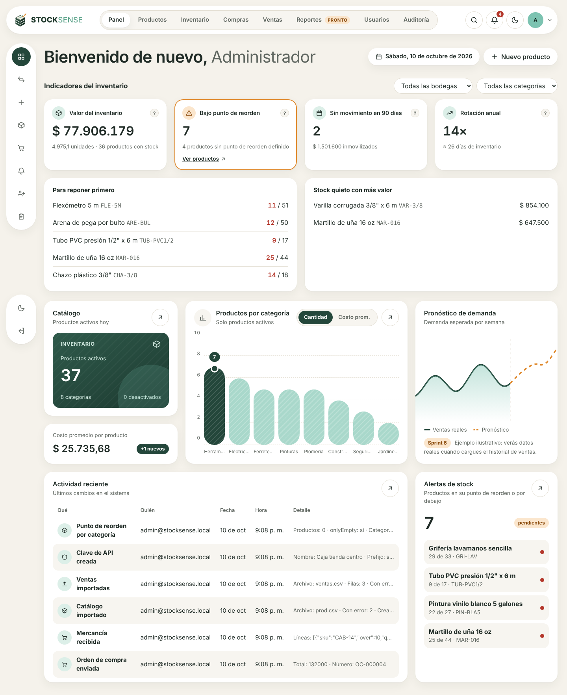
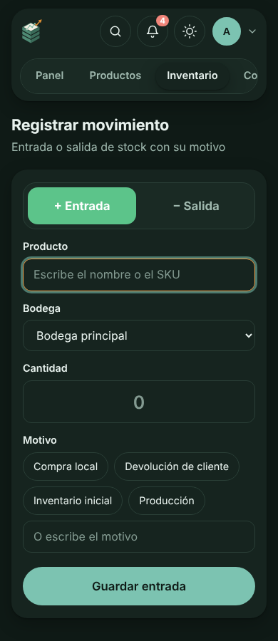
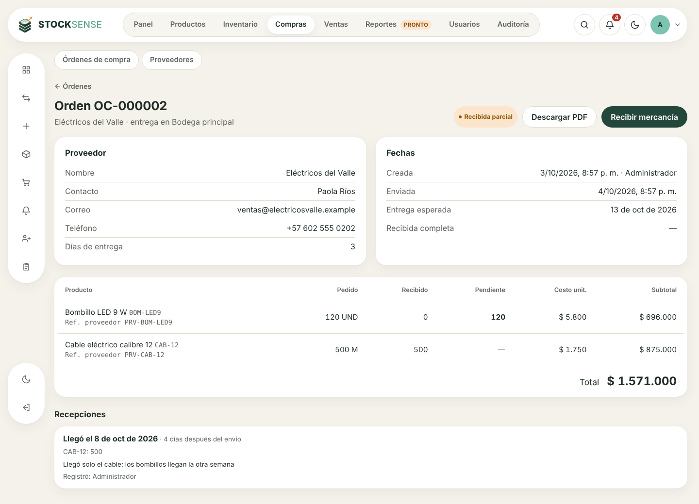

# Entrega de los sprints 2 a 5

**Resultado:** las 14 historias tienen código, pruebas y pantallas. Quedan 2 subtareas que necesitan personas: la prueba de uso en celular de HU-07 (T-07.3) y la aprobación de las fórmulas de los KPIs (T-27.1).

Pruebas en verde: **113 de backend** (64 nuevas, contra PostgreSQL 16 real; 90 % de cobertura en sentencias), **12 de frontend** y **9 del servicio de pronóstico en Python**.

| Sprint | Historia | Jira | Evidencia automática |
| --- | --- | --- | --- |
| 2 | HU-05 Importar el catálogo desde un CSV | GG-15 | `backend/test/imports.e2e-spec.ts` |
| 2 | HU-06 Ver el stock actual por bodega | GG-16 | `backend/test/inventory.e2e-spec.ts` |
| 2 | HU-07 Registrar entradas y salidas | GG-17 | `backend/test/inventory.e2e-spec.ts` |
| 2 | HU-10 Gestionar proveedores | GG-20 | `backend/test/purchases.e2e-spec.ts` |
| 3 | HU-08 Transferir entre bodegas | GG-18 | `backend/test/inventory.e2e-spec.ts` |
| 3 | HU-09 Conteo físico y ajustes | GG-19 | `backend/test/inventory.e2e-spec.ts` |
| 3 | HU-13 Importar el historial de ventas | GG-23 | `backend/test/imports.e2e-spec.ts` |
| 4 | HU-11 Crear órdenes de compra | GG-21 | `backend/test/purchases.e2e-spec.ts` |
| 4 | HU-12 Recibir mercancía contra una orden | GG-22 | `backend/test/purchases.e2e-spec.ts` |
| 4 | HU-14 Recibir ventas por API | GG-24 | `backend/test/sales-api.e2e-spec.ts` |
| 4 | HU-15 Punto de reorden y stock de seguridad | GG-25 | `backend/test/reorder-alerts-kpis.e2e-spec.ts` |
| 5 | HU-16 Alertas de stock bajo | GG-26 | `backend/test/reorder-alerts-kpis.e2e-spec.ts` |
| 5 | HU-18 Preparar los datos para el modelo | GG-28 | `forecast/tests/` |
| 5 | HU-27 Dashboard con KPIs | GG-37 | `backend/test/reorder-alerts-kpis.e2e-spec.ts` |

## Criterios de aceptación verificados

| Criterio | Resultado |
| --- | --- |
| HU-05: CSV de 5.000 filas en menos de 60 s | 0,8 s. Volver a subirlo actualiza, no duplica |
| HU-05: filas con error se descargan con fila y motivo sin perder las válidas | Archivo `errores-….csv` desde la pantalla |
| HU-06: stock por bodega y total; sin movimientos = 0 | Ficha del producto y pantalla Inventario › Stock |
| HU-06: una bodega con stock no se desactiva | 409 con cuánto stock tiene |
| HU-07: entrada de 20 sube 20 con usuario, fecha y motivo | Movimiento inmutable (la base de datos impide editarlo) |
| HU-07: salida mayor al stock se rechaza y dice cuánto hay | «Stock insuficiente de MAR-001 en Bodega principal: hay 6 UND…». 8 salidas simultáneas nunca dejan el stock negativo |
| HU-08: A baja 10, B sube 10, el total no cambia | El total incluye lo que va «en camino» mientras la transferencia está pendiente |
| HU-08: estado y quién confirmó en destino | Pendiente → Recibida (o Cancelada, que devuelve el stock) |
| HU-09: diferencia por producto, aprobación del Administrador, ajuste «Conteo físico» en la auditoría | Flujo Abierto → En revisión → Aprobado/Rechazado |
| HU-10: proveedor con contacto y días de entrega, asignable a productos; con órdenes solo se desactiva; búsqueda por nombre o correo | Cambios en la auditoría |
| HU-11: orden con 3 productos queda Enviada con el total | Total calculado y guardado al enviar; PDF descargable |
| HU-11: producto sin proveedor no se agrega y dice cómo corregirlo | Mensaje con la ruta «Proveedores › … › Productos» |
| HU-12: de 100 recibo 60 → Recibida parcial con 40 pendientes | Stock +60 en la bodega de la orden |
| HU-12: recibir de más pide confirmación y queda anotado | «Sobrante aceptado: TOR-1 +2» |
| HU-12: fecha real para el tiempo de entrega | Promedio real por proveedor visible en su ficha |
| HU-13: 24 meses × 1.000 productos en menos de 3 min, sin duplicar | ≈ 243.000 filas en 15 s; la segunda carga deja todo «sin cambios» |
| HU-13: SKU inexistentes se reportan sin detener la carga | Informe de calidad: SKU desconocidos, negativos, fechas futuras, huecos de 7+ días |
| HU-14: venta con clave válida baja el stock y queda en el historial; clave inválida = 401 | Reenviar el mismo `externalId` no duplica (también con envíos simultáneos) |
| HU-14: API documentada con ejemplos | `/api/docs` (Swagger) con botón «Try it out» |
| HU-15: se guardan y aparecen en la ficha; ni vacíos ni negativos; edición por categoría | Sugerencia con la fórmula y la demanda real de 90 días |
| HU-16: alerta en la app y por correo; máximo un correo al día por producto; se cierra sola | Campana con contador; cada persona puede apagar el correo |
| HU-18: serie semanal sin huecos; menos de 12 semanas = datos insuficientes; corre programado y deja registro | Servicio Python (FastAPI) con ejecución diaria a las 02:00 y botón «Ejecutar ahora» |
| HU-27: valor, bajo reorden, sin movimiento 90 días y rotación; filtros por bodega y categoría en menos de 2 s; ayuda por KPI | 14 ms con los datos de demostración. Fórmulas en [kpis.md](kpis.md) |







## Pendiente que necesita personas

1. **T-07.3 (GG-62):** cronometrar con 3 personas de bodega un registro completo desde el celular (meta: menos de 2 minutos). La pantalla ya está pensada para eso: botones grandes, motivos frecuentes con un toque y la última bodega recordada.
2. **T-27.1 (GG-120):** que la dueña del producto lea [kpis.md](kpis.md) y lo apruebe (hay una tabla al final para anotarlo).

## Cómo probarlo con datos

```bash
cd backend
npm run build
npm run seed        # administrador y categorías
npm run seed:demo   # 36 productos, 3 bodegas, 4 proveedores, 18 meses de ventas, alertas y 3 órdenes
```

Con Docker: `docker compose exec backend npm run seed:demo`.
Después abre **Ventas › Datos del modelo › Ejecutar ahora** para preparar las series semanales.

## Decisiones tomadas

- **El stock vive en `stock_levels` y cada cambio pasa por un solo servicio (`StockLedger`)** que bloquea la fila, valida que no quede negativo, guarda el movimiento y evalúa las alertas en la misma transacción. La base de datos tiene además un `CHECK` (stock ≥ 0) y un trigger que impide editar o borrar movimientos.
- **Transferencias en dos pasos:** el stock sale del origen al crearla («en camino») y entra al destino cuando alguien lo confirma allí. Así se ve quién recibió y el total del producto nunca cambia.
- **Ventas históricas ≠ ventas del punto de venta:** el historial importado no mueve el stock actual (son ventas pasadas); las ventas que llegan por API sí lo descuentan.
- **Una alerta abierta por producto** (índice único en la base). Si se cierra y vuelve a abrirse el mismo día, se reabre sin otro correo.
- **El servicio de pronóstico no crea tablas:** las migraciones de la API son la única fuente del esquema; Python solo lee ventas y escribe `weekly_sales`, `forecast_series` y `pipeline_runs`.
- **Bodega ve las órdenes de compra sin costos** para poder recibir mercancía (permiso nuevo `purchases:receive`).
- Nuevos permisos y quién los tiene: ver [roles-y-permisos.md](roles-y-permisos.md).
