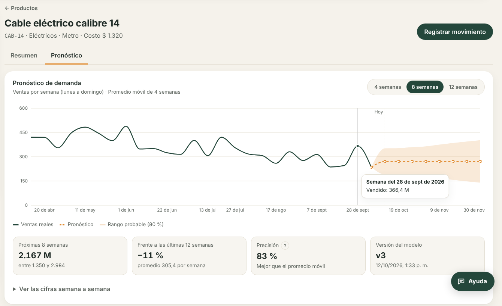
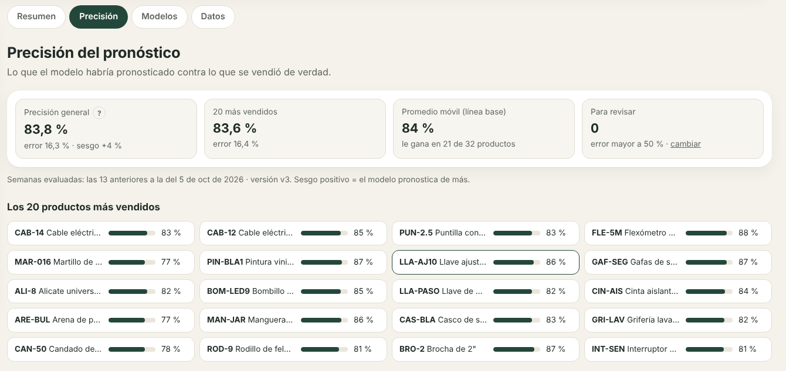
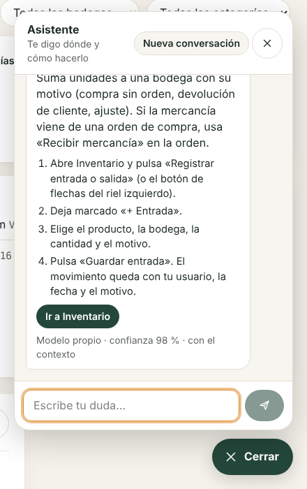
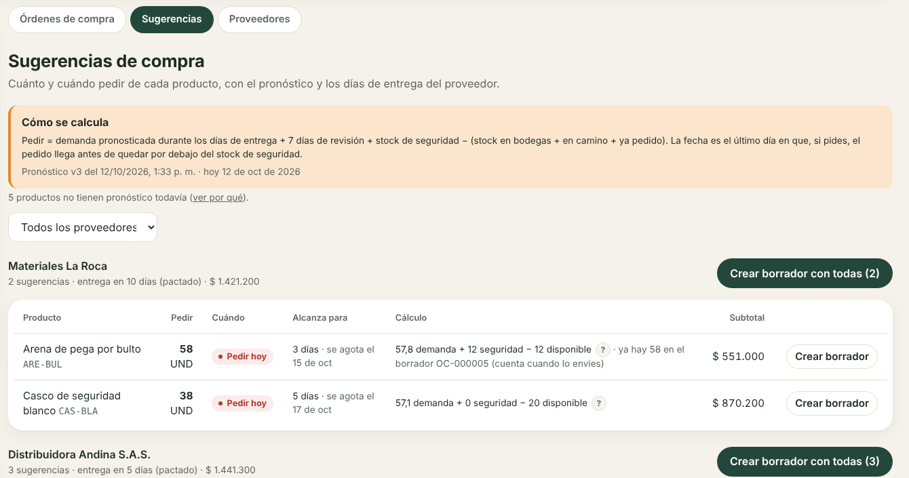
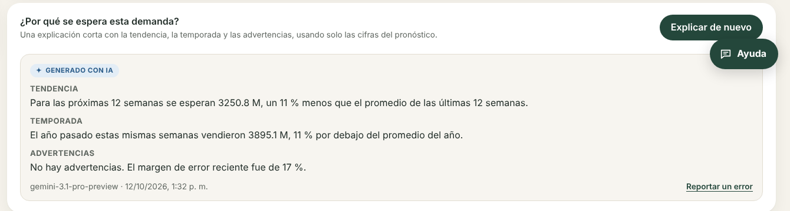

# Entrega de los sprints 6 a 8

**Resultado:** las 11 historias tienen código, pruebas y pantallas. Quedan 2 cosas que necesitan personas: repetir la comparación de técnicas con las ventas reales (T-19.1) y probar Gemini con la clave real del proyecto (HU-23).

Pruebas en verde: **156 de backend** (43 nuevas; 91 % de cobertura en sentencias), **16 de frontend** y **32 del servicio de Python** (23 nuevas, 4 de ellas contra PostgreSQL real).

| Sprint | Historia | Jira | Evidencia automática |
| --- | --- | --- | --- |
| 6 | HU-19 Calcular el pronóstico base de demanda | GG-29 | `forecast/tests/test_models.py`, `forecast/tests/test_jobs.py` |
| 6 | HU-20 Ver el pronóstico en un gráfico | GG-30 | `backend/test/forecast-ai.e2e-spec.ts` |
| 6 | HU-32 Base de conocimiento de las funciones | GG-136 | `frontend/src/test/knowledge-routes.test.ts`, `backend/src/assistant/knowledge.spec.ts` |
| 7 | HU-21 Medir la precisión del modelo | GG-31 | `backend/test/forecast-ai.e2e-spec.ts`, `forecast/tests/test_models.py` |
| 7 | HU-22 Reentrenar de forma programada | GG-32 | `forecast/tests/test_jobs.py`, `backend/test/forecast-ai.e2e-spec.ts` |
| 7 | HU-23 Conectar Gemini de forma segura | GG-33 | `backend/test/forecast-ai.e2e-spec.ts`, `backend/src/ai/data-filter.spec.ts` |
| 7 | HU-33 Entrenar el modelo propio del asistente | GG-137 | `forecast/tests/test_assistant.py` |
| 7 | HU-34 Preguntarle al asistente | GG-138 | `backend/test/assistant.e2e-spec.ts` |
| 8 | HU-17 Sugerencias de reposición | GG-27 | `backend/test/suggestions.e2e-spec.ts`, `backend/src/purchases/suggestions.spec.ts` |
| 8 | HU-24 Explicar el pronóstico | GG-34 | `backend/test/forecast-ai.e2e-spec.ts`, `backend/src/forecast/number-check.spec.ts` |
| 8 | HU-35 Responder con Gemini cuando el modelo no sabe | GG-139 | `backend/test/assistant.e2e-spec.ts` |

Las pruebas de Gemini usan un servidor simulado que responde con el mismo formato de la API de Google; así se prueban también las fallas, los 10 segundos y los reintentos sin gastar dinero.

## Criterios de aceptación verificados

| Criterio | Resultado |
| --- | --- |
| HU-19: con 12 semanas o más, pronóstico de 4 a 12 semanas con mínimo y máximo | 12 semanas guardadas con rango del 80 %; el rango cubrió el 83,4 % de las semanas reales |
| HU-19: se compara contra el promedio móvil y se guarda cuál ganó | Técnica, parámetros, error propio y de la línea base por producto, por versión |
| HU-19: 1.000 productos en menos de 10 minutos | Unos 3 segundos (prueba automática con 1.000 series de 2 años) |
| HU-20: historia, pronóstico y rango en un gráfico | Pestaña Pronóstico de la ficha; verde = real, ámbar = pronóstico |
| HU-20: horizonte 4, 8 o 12 en menos de 2 s | 140 a 160 ms en el navegador; la API responde en unos 10 ms |
| HU-20: datos insuficientes con qué hacer | «Tiene 8 semanas de ventas y el modelo necesita al menos 12…» con botón para cargar historial |
| HU-21: error por producto en semanas ya transcurridas | Prueba hacia atrás en las últimas 13 semanas, WAPE y sesgo por producto |
| HU-21: precisión general y de los 20 más vendidos | 83,8 % y 83,6 % con los datos de demostración |
| HU-21: umbral configurable | Configuración de IA; cambia las marcas al instante, sin reentrenar |
| HU-22: calendario semanal configurable | Día y hora en Configuración de IA; la cola nunca encola dos veces el mismo turno |
| HU-22: si el nuevo es peor se conserva el anterior con el motivo | Se comparan en las mismas semanas y productos; el motivo queda en la versión |
| HU-22: una falla avisa al equipo técnico | Un reintento y luego correo a `TECH_ALERT_EMAILS` (o administradores) |
| HU-23: la clave nunca llega al navegador | Solo en el servidor; prueba que revisa que no aparece en las respuestas |
| HU-23: solo datos agregados | Lista blanca de campos y limpieza de texto libre; pruebas sin costo ni correos |
| HU-23: límite por persona y mes con mensaje amable | «Ya usaste tus 100 consultas con IA de este mes…»; ajustable |
| HU-23: falla o más de 10 s muestra el resultado estadístico | Probado con un Gemini simulado lento y con errores 503 |
| HU-24: máximo 120 palabras con tendencia, estacionalidad y advertencias | Formato JSON de tres campos y validación de largo |
| HU-24: validador de cifras | Rechaza «937 unidades» si 937 no está en los datos; reintenta una vez |
| HU-24: «Generado con IA» y reportar errores | Etiqueta y botón; los reportes llegan a Configuración de IA |
| HU-32: ficha con ruta, pasos, permisos y 20 o más ejemplos; 100 % de rutas | 44 fichas, todas las rutas cubiertas |
| HU-32: una pantalla nueva sin ficha hace fallar una prueba | «Rutas sin ficha en articles.json: /pantalla-nueva» |
| HU-32: la API de fichas filtra por rol | Bodega no ve «Crear una orden de compra» |
| HU-33: modelo con versión y métricas | `assistant_models` con acierto, matriz de confusiones y cobertura por umbral |
| HU-33: 85 % en preguntas no vistas | 87,4 % en 151 preguntas escritas a mano |
| HU-33: confianza de 0 a 1 y umbral por configuración | Umbral en Configuración de IA (55 % por defecto) |
| HU-33: menos de 300 ms | Unos 2 ms por pregunta |
| HU-34: «¿cómo registro una salida?» da pasos y botón | Botón «Ir a Inventario» abre el formulario con Salida marcada |
| HU-34: sin permiso dice a quién pedírselo y no muestra la ruta | «Tu rol (Bodega) no tiene permiso… Pídeselo a una persona administradora… o a alguien con rol Compras.» |
| HU-34: recuerda la conversación | «¿y una entrada?» responde con la ficha de entradas (confianza 98 %) |
| HU-34: desde cualquier pantalla, escritorio y celular | Botón «Ayuda» flotante; en celular ocupa toda la pantalla |
| HU-35: Gemini recibe pregunta, conversación y fichas; respuesta marcada | «Respondido con Gemini» |
| HU-35: solo usa lo que recibe; rutas validadas | Solo fichas del rol; rutas fuera del catálogo se quitan antes de mostrar |
| HU-35: falla o más de 10 s muestra mensaje y fichas cercanas | Probado con errores y demoras simuladas |
| HU-35: nunca contraseñas, claves, costos ni datos personales | Prueba con «mi contraseña es…» y un correo: no llegan a Gemini |
| HU-17: cantidad y fecha por producto | «Pedir hoy», «Esta semana · 14 de oct»… |
| HU-17: cómo se calculó | Demanda pronosticada, stock de seguridad, disponible, en camino y ya pedido |
| HU-17: borrador de orden con un clic | «Crear borrador» por fila o «Crear borrador con todas» por proveedor |











La captura de la explicación se tomó con un Gemini simulado (en este entorno no hay clave real); el texto real lo redacta Gemini con las mismas reglas.

## Pendiente que necesita personas

1. **T-19.1 (GG-96):** repetir la comparación de técnicas con las ventas reales del negocio: `python -m research.compare_models` (ver forecast/README.md). Con los datos de demostración ya está hecha y documentada en [pronostico-e-ia.md](pronostico-e-ia.md).
2. **HU-23 (GG-33):** poner la clave real en el `.env` del servidor, abrir un producto › Pronóstico › Explicar y hacerle al asistente una pregunta rara (por ejemplo «necesito mandar cajas al local del centro»). Revisar que aparezcan «Generado con IA» y «Respondido con Gemini» y que el consumo quede en Configuración de IA.

## Cómo probarlo con datos

```bash
docker compose up --build
docker compose exec backend npm run seed:demo
```

1. Entra como administrador. El asistente se entrena solo al arrancar el servicio de Python (unos 10 segundos).
2. **Pronóstico › Modelos › Reentrenar ahora** (o espera al lunes 03:00). En uno o dos minutos aparece la versión.
3. Abre un producto › **Pronóstico**, cambia el horizonte y pulsa **Explicar** (con `GEMINI_API_KEY` en el `.env`).
4. **Compras › Sugerencias** y crea un borrador con un clic.
5. Pulsa **Ayuda** abajo a la derecha y pregunta «¿cómo registro una salida?» y luego «¿y una entrada?».
6. Tu avatar › **Configuración de IA** para cambiar umbrales, horario y límite, y ver el consumo.

## Decisiones tomadas

- **Pronóstico propio en numpy, sin Prophet:** más preciso y unas 1.000 veces más rápido en los datos de prueba (ver la tabla en [pronostico-e-ia.md](pronostico-e-ia.md)). Prophet queda solo en el script de investigación.
- **Cola de trabajos en PostgreSQL (`ml_jobs`):** no hace falta otro servicio (Redis, RabbitMQ). `FOR UPDATE SKIP LOCKED` evita que dos copias tomen el mismo trabajo.
- **Champion/challenger justo:** el modelo nuevo y el vigente se comparan en las mismas semanas con los datos nuevos, no con el error que tuvo cada uno en su momento.
- **Gemini solo desde la API:** la clave, los límites, el filtro de datos y el registro de consumo viven en un solo lugar (`backend/src/ai/`).
- **El asistente funciona sin Gemini:** el modelo propio responde solo el 87 % de las preguntas de prueba (con un acierto del 95 % en esas) y, sin clave o sin cupo, sugiere las fichas más cercanas.
- **La navegación se reordenó:** nueva sección **Pronóstico** (Resumen, Precisión, Modelos, Datos; «Datos del modelo» salió de Ventas y su ruta vieja redirige). Usuarios, Auditoría y Configuración de IA pasaron al menú del avatar para que la barra no se desborde.
- **Arreglo de paso:** `npm run migration:run` fallaba porque `data-source.ts` exportaba la conexión dos veces; ahora funciona y lo usa el CI para migrar la base del servicio de Python.
- Nuevo permiso `ai:manage` (solo Administrador). Ver [roles-y-permisos.md](roles-y-permisos.md).
